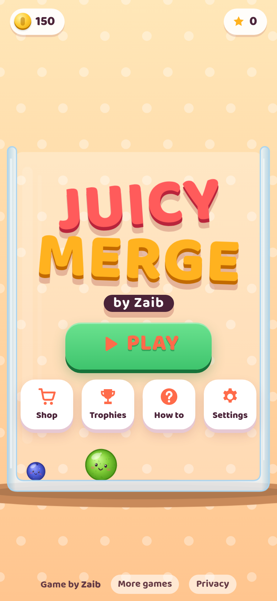
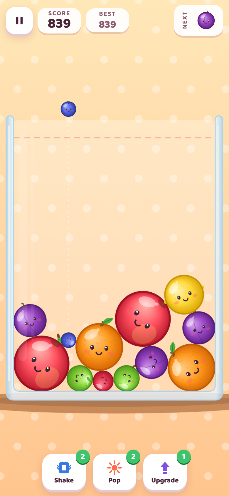

# Juicy Merge by Zaib

**Play:** https://zaibgames.com/juicy-merge/

A fruit merge physics puzzle. Drop fruits into the jar. When two of the same fruit touch, they merge into the next size up, from Blueberry all the way to Watermelon. Keep the jar below the red line!

 

## Features
- Custom circle physics engine: 10 substeps × 3 solver iterations, Coulomb friction coupled with rolling, sleeping for rock-solid stacks (no jitter, no tunnelling)
- 11 fruit sizes with cute faces that blink and look worried near the red line
- Juicy merges: juice splashes, rings, sparkles, splats on the glass, squash and stretch, screen shake, vibration
- Combo chains with score multipliers (up to x4)
- Next-fruit preview, aim guide, and a danger line with a 3-second grace countdown
- Modes: **Classic** (endless), **Timed** (90 s, big merges add time) and **Daily Challenge** (the same fruit order for everyone, with a daily goal and a coin reward)
- Power-ups: **Shake**, **Pop** and **Upgrade**
- Shop: 6 themed jars, 5 fruit skins (Fresh, Candy, Kitty, Cosmic, Neon) and power-up packs, all bought with coins
- 19 achievements, best score per mode, interactive tutorial
- Synthesized WebAudio music and sound effects behind a master limiter
- Mobile-first: portrait and landscape layouts, safe areas, touch, mouse and keyboard, auto quality fallback, pauses when the tab is hidden

## Controls
| Action | Touch / Mouse | Keyboard |
|---|---|---|
| Aim | Drag / move | ← → or A D |
| Drop | Release / click | Space, ↓, S or Enter |
| Power-ups | Buttons | 1 / 2 / 3 (← → to pick a fruit, Enter to apply) |
| Pause | II button | P or Esc |

Single self-contained `index.html` with no external libraries. Progress is saved in localStorage.

Game by Zaib · [More games](https://zaibgames.com/) · [Privacy](https://zaibgames.com/privacy/)
